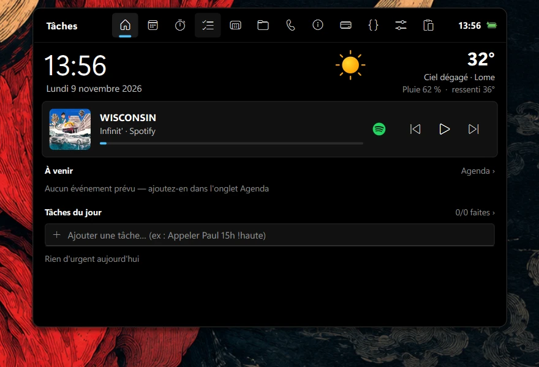
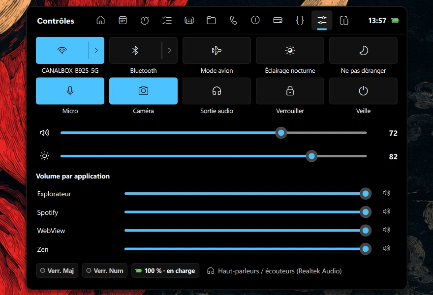
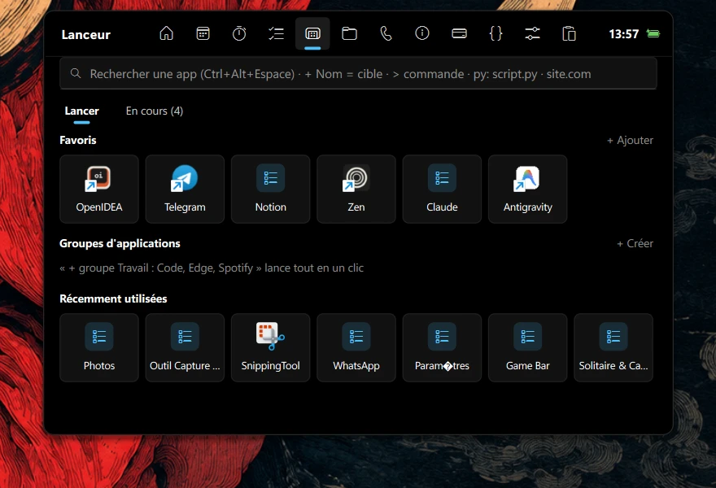
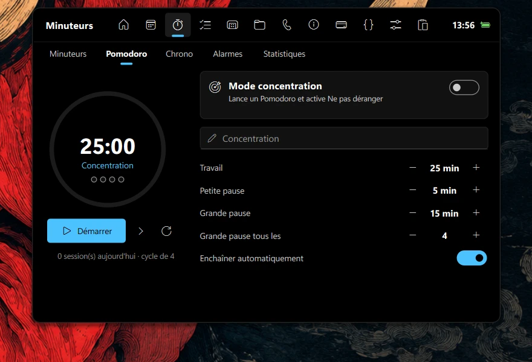
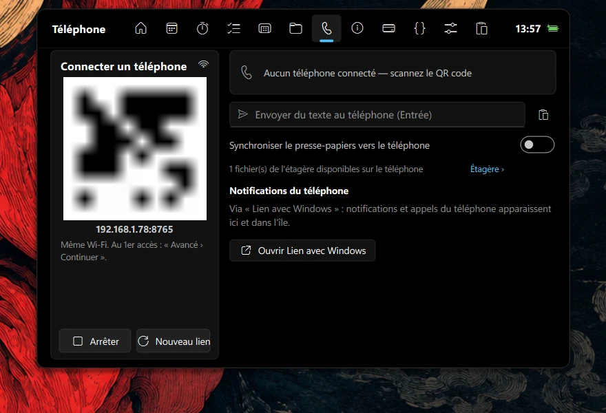

# Dynamic Island for Windows 11

A floating **black island** at the top of the screen, inspired by the iPhone Dynamic Island and
drawn in the **Windows 11** style: 9–10 px corners, the Windows accent color and Fluent icons.
It replaces the taskbar: time, media, notifications, quick settings, application launcher,
files, phone and more are all available from the island.

Built with Python and **PySide6** (Qt), with no mandatory online service.

<p align="center">
  <br>
  <em>When closed, the island shows the essentials (here, the current media)</em>
</p>

## Overview

| Home | Controls |
|---|---|
|  |  |
| **Launcher** | **Timers** |
|  |  |
| **Phone** | |
|  | |

---

## How it works

| Gesture | Effect |
|---|---|
| Hover | Opens the island with a spring animation |
| Click the pill | Keeps it open; click elsewhere or press `Esc` to close |
| Right-click | Menu: keep open, start with Windows, taskbar, synchronization, quit |
| Mouse wheel over the closed pill | Volume |
| `Ctrl+Alt+V` | Clipboard history with search |
| `Ctrl+Alt+Space` | Application launcher |
| Drop files on the island | They wait on the shelf |
| Click a dock icon | Shows the application, or minimizes it when already in front |
| Right-click a dock icon | Application windows, show, minimize, close, force stop |

**Open-application dock**: a second black island to the right of the pill shows icons for open
applications. An accent line marks the foreground application, minimized applications are dimmed,
names appear on hover and `+N` appears beyond nine applications. The dock fades out while the
island is open. It can be disabled from the island context menu.

**Closed pill**: depending on context it shows the time, the active timer, an upcoming meeting,
the current media or a running build. Green and orange dots indicate camera and microphone use.

**Island notifications**: volume, track changes, audio output, battery, Caps Lock, timer completion,
reminders, failed CI, phone files, incoming calls and more.

**Always available**: the island stays above other windows, including fullscreen applications,
starts with Windows and is supervised by a watchdog (`island_watchdog.pyw`) that restarts it
after a crash.

**Permanently hidden taskbar**: the taskbar remains hidden even on hover. The Windows key still
opens the Start menu. To restore it, right-click the island and clear *Hide the taskbar*, or choose
*Quit*. If the island crashes repeatedly, the watchdog restores the taskbar.

---

## Tabs

| Tab | Contents |
|---|---|
| **Home** | Time, date, weather, media player (button to **open the playing application**: Spotify, browser…), upcoming events with a *Join* button, birthdays, daily tasks and active timers |
| **Agenda** | Upcoming · Week · Month · Accounts. Quick entry in English or French (“Meeting tomorrow 2:30 pm”, “Anniversaire Léa 12/03”), editing, deletion, reminders, countdowns and detected Teams / Zoom / Meet links |
| **Timers** | Multiple countdowns (“12m tea”), Pomodoro with breaks, focus mode (enables *Do Not Disturb*), stopwatch with laps, alarms (“7:30 Wake up weekdays”), statistics and history |
| **Tasks** | Today · All · Projects · Notes. “Send quote tomorrow 9am !high #client” creates a task with due date, reminder, priority and project. Pinnable quick notes and search |
| **Launcher** | *Launch*: application search (Start menu and Microsoft Store), favorites, one-click groups and recent applications. *Running*: open applications with their windows and memory use — show, minimize, close or force stop |
| **Files** | Shelf (open, copy/move to…, clipboard, drag to another application), active downloads (percentage and remaining time for Chrome / Edge / Brave), recent files, favorite folders and Desktop shortcuts |
| **Phone** | QR code to open a companion web page on the phone (same Wi-Fi, local HTTPS, secret link): file transfer both ways, text and clipboard in both directions, remote control and battery. Notifications and calls through *Phone Link*. Wi-Fi QR code |
| **Info** | Customizable widgets: weather and forecast, world clock, statistics, quote of the day, RSS news, stocks, favorite photo and calendar |
| **Wallet** | Read-only **Binance** portfolio (Spot, Funding, Earn) in USD / XOF / EUR, 24-hour change, history and hidden mode |
| **Developer** | Open IDE and project (VS Code, IntelliJ, PyCharm, Visual Studio…), Git branch and status, commits, GitHub (PRs, issues, CI, deployments, notifications), Jenkins, local build output and errors, logs, local servers and ports, services and favorite projects |
| **Controls** | Windows 11-style quick settings: **Wi-Fi**, **Bluetooth** and **mobile hotspot** (the `›` chevron opens a detailed panel), network devices, airplane mode, night light, Do Not Disturb, microphone, camera, audio output, lock, sleep, master and per-application volume, brightness |
| **Clipboard** | History of text, links, images and files, search, categories, pinning and direct paste into the active application |

### Wi-Fi, Bluetooth, hotspot and network panels

- **Wi-Fi**: visible networks with signal strength and security, connected network first. One-click
  connection to saved or open networks, password entry for new networks (WPA2 / WPA3), disconnect
  and forget a network (double confirmation).
- **Bluetooth**: paired devices with state. Connect and disconnect headsets and speakers in one click.
  *Add a device* opens Windows pairing.
- **Mobile hotspot**: start and stop Windows connection sharing, set the name, password
  (shown, edited or generated) and band (automatic, 2.4 GHz, 5 GHz), show a QR code for connecting
  a device and list connected devices (name, IP address, MAC address).
  **Blocking** a device is implemented by changing the password and restarting the hotspot, because
  Windows cannot eject a single hotspot client. Other devices reconnect with the new password (QR code).
  A blocked device that returns is reported.
- **Network devices**: devices on the current Wi-Fi (router/box, this computer and other devices with
  IP, MAC and name). Blocking on that network is done from the router administration (*Administer* button).

> Some Wi-Fi adapters cannot create a hotspot while Wi-Fi Direct is already in use by Phone Link,
> nearby sharing or projection. The island reports the cause.

---

## Optional integrations

- **Google Calendar / Outlook / Teams**: Agenda › Accounts › paste the secret iCal address.
- **GitHub**: Developer › GitHub › paste a personal token for notifications and private repositories.
  Public repositories work without a token.
- **Jenkins**: Developer › Builds › enter `URL user token`.
- **Binance**: Wallet › **read-only** API key, then the secret key.
- **Phone**: Phone › Enable › scan the QR code. On first access the browser warns about the local
  certificate: *Advanced › Continue*. Windows may ask to allow Python on the private network.
- **Cloud synchronization**: right-click › *Sync through a cloud folder…* (OneDrive, Google Drive,
  Dropbox). Tasks, notes, local agenda, alarms, sessions and clipboard histories are shared between PCs.
- **Weather**: location estimated from the IP address (ipwho.is), data from Open-Meteo. The city can be
  changed in Info › Edit.

## Data and privacy

Settings and API keys are written immediately to `%APPDATA%\DynamicIsland\settings.json`, so they
survive restarts and reboots. The previous good copy is kept as `settings.json.bak`; a file that
cannot be read is preserved as `settings.json.corrupt` instead of being overwritten. Synchronized
collections (tasks, notes, agenda, clipboard) live in the selected cloud folder; credentials are
never synchronized and stay local to the Windows account. The phone server certificate is also in
`%APPDATA%\DynamicIsland`. None of this is stored in this repository. GitHub, Binance and Jenkins
credentials are stored in plain text; use keys with restricted permissions.

---

## Installation

### Windows installer (recommended)

1. Download **`DynamicIsland-1.1.0-win64.msi`** from the
   [Releases](https://github.com/arielDirema/dynamic-island/releases) page.
2. Run it and follow the wizard. **Administrator rights are not required**: the application installs
   for the current user in `%LOCALAPPDATA%\Programs\Dynamic Island`.
3. Launch **Dynamic Island** from the Start menu or the Desktop shortcut. It will start with Windows
   on subsequent launches.

Windows SmartScreen may display “Windows protected your PC” because the installer is not signed.
Choose *More info* › *Run anyway*.

**Uninstall**: Settings › Apps › Installed apps › *Dynamic Island* › Uninstall. Quit the island first
(right-click › Quit) to restore the taskbar. Your data in `%APPDATA%\DynamicIsland` is preserved.

**Upgrading**: run the newer `.msi`; it replaces the installed version and keeps your data.

**Portable build**: release 1.0.0 also ships `DynamicIsland-1.0.0-portable-win64.zip`, which can be
extracted anywhere and started with `DynamicIsland.exe` without installation. Newer releases are built
automatically by GitHub Actions and publish the `.msi` only.

### From source

Requirements: **Windows 11** and **Python 3.12**.

```powershell
git clone https://github.com/arielDirema/dynamic-island.git
cd dynamic-island
python -m venv .venv
.\.venv\Scripts\python -m pip install -r requirements.txt
```

Launch by double-clicking `start.bat`. It starts the watchdog, which starts the island. Autostart with
Windows is enabled on first launch and can be disabled from the island context menu.

Command-line entry points:

```powershell
.\.venv\Scripts\python src\main.py            # watchdog + island
.\.venv\Scripts\python src\main.py --island   # island only (used by the watchdog)
.\.venv\Scripts\python src\main.py --selftest # report in %TEMP%\DynamicIsland-selftest.txt
```

`island.py`, `dynamic_island.py`, `watchdog.py` and `island_watchdog.pyw` remain at the repository root
as compatibility entry points and delegate to the `src/dynamic_island` package.

### Tests and localization validation

```powershell
.\.venv\Scripts\python -m pytest
.\.venv\Scripts\python -m ruff check src tests scripts
.\.venv\Scripts\python scripts\validate_locales.py
```

The test suite covers shared formatting, English and French date parsing, storage and synchronization,
localization loading and fallback, locale-aware formatting, layer boundaries, import cycles, all module
imports and the full application shell import.

### Build the installer

```powershell
.\.venv\Scripts\python -m pip install cx_Freeze pillow
.\.venv\Scripts\python tools\make_icon.py
.\.venv\Scripts\python setup_msi.py bdist_msi
```

Results: `dist\DynamicIsland-<version>-win64.msi` and the standalone application in `build\`.
`DynamicIsland.exe --selftest` verifies every component and writes its report to
`%TEMP%\DynamicIsland-selftest.txt`.

The **Build MSI** GitHub Actions workflow runs on pushes, pull requests and manual dispatches.
Every run uploads the installer as a workflow artifact. Pushing a `v*` tag also creates or updates
the matching GitHub release and attaches the MSI to it.

## Language support

English is the canonical source language and the fallback locale. French is included as a complete
additional locale. The application selects a stored user preference first, then the system language,
then English.

Language files are external JSON catalogs:

```text
locales/
├── en/messages.json
└── fr/messages.json
```

Each catalog contains metadata, shared UI keys, feature namespaces and localized content such as
quotes. A new language only requires a new directory with a complete `messages.json`; no Python source
change is needed. The language selector is available in the island context menu and uses each language's
native name. Selecting a language updates the window, tab labels, menus, formatted dates and numbers
without a restart. The phone web page is rendered in the active language on its next request or reload.

To add a language:

1. Copy `locales/en/messages.json` to `locales/<locale>/messages.json`.
2. Translate every value while keeping the key structure and placeholders unchanged.
3. Update the `meta` block (`language`, `native_name`, `english_name`, `direction`).
4. Run `python scripts/validate_locales.py`.

The validator reports missing, extra and empty keys, duplicate JSON keys, placeholder mismatches,
invalid metadata, unsupported locale identifiers and source keys missing from the canonical catalog.

## Project structure

```text
src/
├── main.py                          source entry point (watchdog, island, self-test)
└── dynamic_island/
    ├── app.py                       single instance, window, icon and Qt loop
    ├── main.py                      CLI and self-test
    ├── core/
    │   ├── application/             watchdog and Windows autostart
    │   ├── config/                  paths and persistent settings
    │   ├── localization/            catalog loader, resolver, manager and public API
    │   └── utilities/               animation and shared formatting
    ├── models/                      domain keys and metadata
    ├── infrastructure/
    │   ├── storage/                 JSON collections and synchronization
    │   └── windows_api.py           shared Win32 calls
    ├── engines/                     agenda, timers, tasks, files, media, network…
    ├── services/                    phone server and system controls
    └── ui/
        ├── windows/                 island window and layout constants
        ├── components/              drawing, island painting and tray menu
        ├── tabs/                    one module per tab plus an explicit registry
        ├── themes/                  Windows 11 theme
        └── resources/               Fluent icons
locales/<language>/messages.json     external translations
resources/phone_page.html            phone web page template
scripts/validate_locales.py          localization validator
tests/unit/, tests/architecture/
assets/island.ico
```

Dependency rules and architectural decisions are documented in
[`docs/ARCHITECTURE.md`](docs/ARCHITECTURE.md).

## Contributing

See [`CONTRIBUTING.md`](CONTRIBUTING.md). Issues, pull requests, commit messages and technical
discussions are expected in English. Keep user-facing strings in the external catalogs and run the
localization validator before opening a pull request.

## Security

See [`SECURITY.md`](SECURITY.md) for reporting vulnerabilities and the local-data model.

## License

No license file is currently included in this repository. Add an explicit license before redistributing
or reusing the project outside its current distribution channels.
